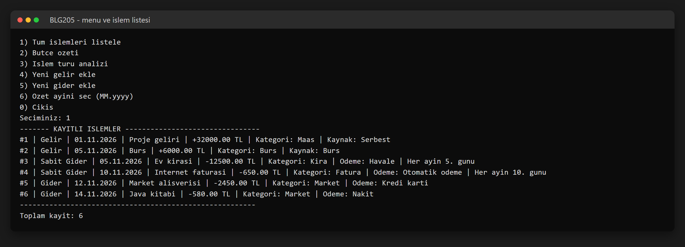
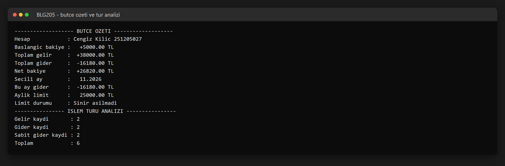
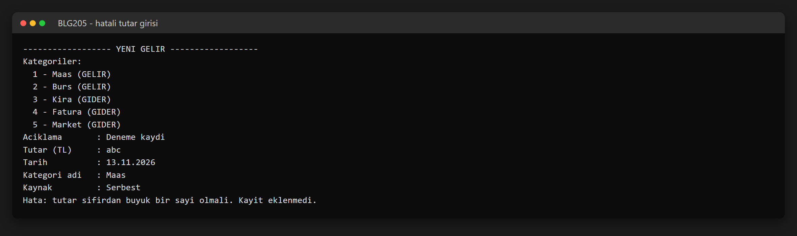

# Kişisel Gelir Gider ve Bütçe Takip Sistemi

BLG205 Nesne Tabanlı Programlamaya Giriş, dönem projesi
Cengiz Kılıç, 251205027
İstanbul Rumeli Üniversitesi, Yapay Zekâ ve Makine Öğrenmesi

Konsol tabanlı, veritabanı kullanmayan, verisini metin dosyasında tutan bir bütçe
takip uygulaması. Saf Java, harici kütüphane yok.

**Depo:** https://github.com/gecekargosu/blg205-butce-takip

## Ekran görüntüleri

Menü ve kayıtlı işlemlerin listesi:



Bütçe özeti ve işlem türü analizi:



Hatalı tutar girişinde doğrulama, kayıt eklenmez:



## Durum

| Aşama | Tarih | Durum |
|---|---|---|
| Ara teslim (UML, iskelet kod, kalan işler planı) | 22 Kasım 2026 | Tamamlandı |
| Final teslimi | 18 Aralık 2026 | Devam ediyor |
| Sunum | 23 Aralık 2026 | Bekliyor |

## Klasör yapısı

```
Rapor.pdf            ara teslim raporu, 13 sayfa
README.txt           derleme ve çalıştırma talimatları
UML/                 UML sınıf diyagramı (pdf iki sayfa, png, svg, üreteç betiği)
Kod/src/             java kaynak kodları, 8 dosya, 3 paket
Kod/javadoc/         sınıf ve metot belgeleri (index.html)
Kod/konsol-kayitlari/ rapora giren gerçek çalışma çıktıları
Kalan_Isler/         çalışma takvimi (pdf ve xlsx)
00_Kapak/            rapor üreteçleri, terminal görüntüleme betiği ve
                     ekran görüntüleri (ekran/ klasörü, pakete girmez)
```

## Derleme ve çalıştırma

```
cd Kod
javac -encoding UTF-8 -d build src/model/*.java src/service/*.java src/app/*.java
java -cp build app.Main
```

## Sınıflar

`model` paketi: Islem (soyut), Gelir, Gider, SabitGider, Kategori, ButceHesabi
`service` paketi: ButceService
`app` paketi: Main

Kalıtım zinciri üç seviyeli: Islem → Gider → SabitGider.

## Tamamlanan özellikler

- Sekiz sınıf, üç paket, bütün alanlar private
- Doğrulamalı setter metotları, geçersiz değer eski değeri koruyor
- Otomatik sıra numarası için static sayaç
- Soyut sınıf ve iki soyut metot, alt sınıflarda ezilmiş
- Üst sınıf türünden dizi ile çok biçimlilik
- Menü, işlem listesi, bütçe özeti, işlem türü analizi, ay filtresi
- Gelir ve gider ekleme akışları, tarih ve kategori doğrulaması
- Hatalı girişte çökmeme

## Sıradaki özellikler

| Özellik | Hafta | Planlanan tarih |
|---|---|---|
| Arayüz ve Comparable | 9 | 24-30 Kasım |
| Özel istisna ve try-catch | 10 | 24-30 Kasım |
| ArrayList, HashMap, Repository<T> | 11-12 | 1-7 Aralık |
| Dosya işlemleri | 13 | 1-7 Aralık |
| Lambda ve Stream raporları | 15 | 8-14 Aralık |
| JUnit testleri | 12 | 8-17 Aralık |

## Notlar

- Kod, dersin ilk on haftasında işlenen konularla sınırlı tutuldu. Sonraki konular
  işlendikçe eklenecek, böylece sunumda her satır açıklanabiliyor.
- Kaynak dosyalar ASCII tutuldu, belgeler tam Türkçe karakter kullanır.
- Yapay zekâ kullanımı raporun 9.1 bölümünde açıklanmıştır.
